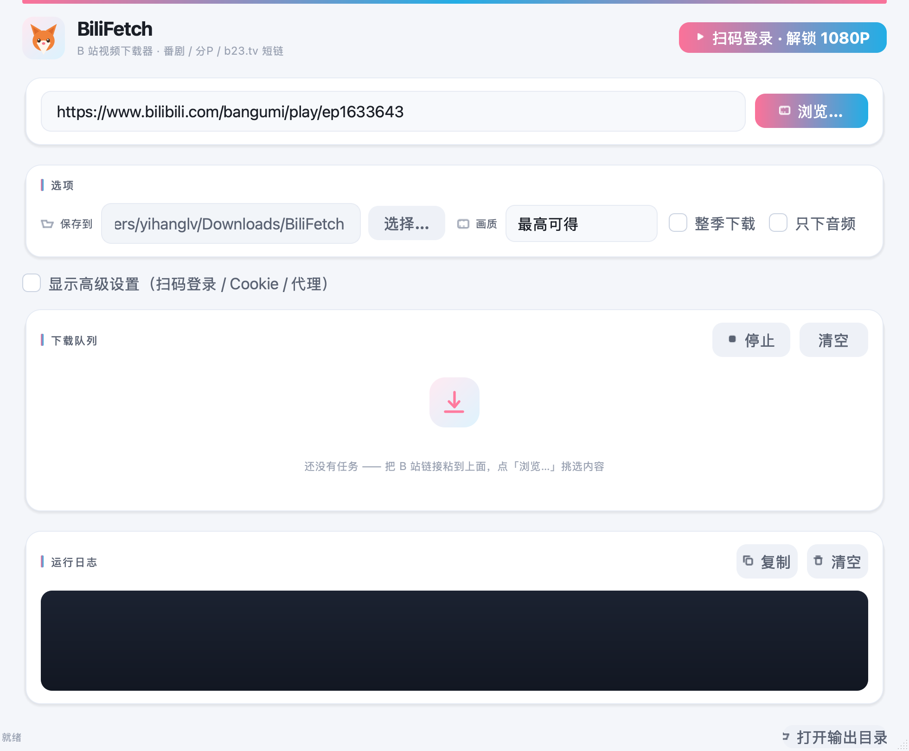
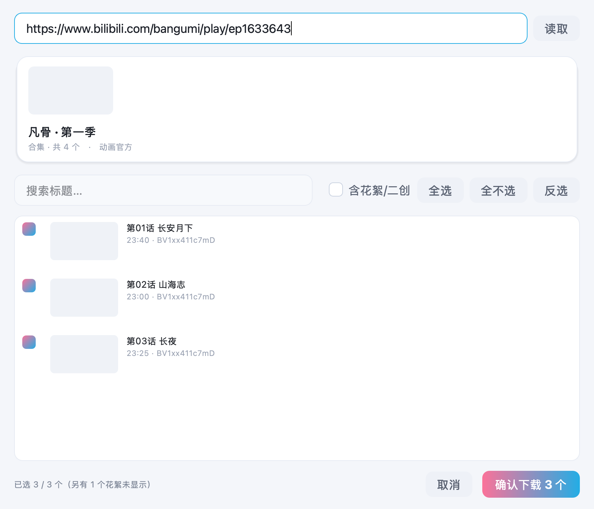

# bilifetch —— B 站视频下载器（macOS / Linux）

参考上游项目 [nICEnnnnnnnLee/BilibiliDown](https://github.com/nICEnnnnnnnLee/BilibiliDown)（Java/Swing GUI）
的 API 调用流程重写的**图形界面 + 命令行**版本。上游发布包只自带 `ffmpeg.exe`，在 macOS / Linux 上要自己补
ffmpeg、还要跑 JVM；这个版本 macOS 下是一个自包含的 `.app`（双击即用，用户机器不需要装 Python），
Linux 下是 `.deb`（图形界面用系统的 python3-pyqt5）。



> 图标是用图像模型生成的简约小狐狸（扁平风），素材存在
> `packaging/app/fox_source.png`，打包时由 `packaging/app/make_icon.py` 合成 macOS 的 `.icns`；
> 界面里那只狐狸是同一只，用矢量代码现画（`bilifetch_ui.py` 的 `draw_fox`），任何尺寸都清晰。

---

## 1. 安装

### macOS —— 下载 `.dmg`

1. 打开 `BiliFetch-1.0.0-macOS.dmg`
2. 把 **BiliFetch.app** 拖到右边的 **Applications** 图标上
3. 装完在「应用程序」里就有图标了 —— 双击打开就是图形界面，
   粘贴 B 站链接 → 点「开始下载」→ 下面看进度条和日志

> 第一次双击如果提示"无法验证开发者"：**右键点 BiliFetch.app → 打开 → 再点"打开"**。
> 这是因为没做公证（notarization），不是文件坏了。

**Homebrew（最省事，brew 会自动去掉隔离属性，不会有上面那个弹窗）**

```bash
brew install --cask bilifetch
```

cask 文件在 `packaging/homebrew/bilifetch.rb`，发布到 GitHub Release 之后记得把
里面的 `url` 和 `sha256` 换成实际的。

**只要命令行**

```bash
# DMG 里双击「安装命令行工具.command」，或者手动：
sudo ./便携版/install.sh
```

### Linux —— 下载 `.deb`

```bash
sudo apt install ./bilifetch_1.0.0_all.deb
# 或者
sudo dpkg -i bilifetch_1.0.0_all.deb
```

装完在应用菜单里能找到 **BiliFetch**（图形界面），终端里也能用 `bilifetch`。

### 依赖

| 依赖 | macOS | Debian/Ubuntu |
|---|---|---|
| Python 3.7+ | App 自带，不用装 | `apt install python3` |
| requests | App 自带 | `apt install python3-requests` |
| PyQt5 | App 自带 | `apt install python3-pyqt5`（deb 已声明依赖） |
| qrcode | App 自带 | `apt install python3-qrcode`（deb 已声明依赖） |
| ffmpeg | `brew install ffmpeg` | `apt install ffmpeg` |

只有 **ffmpeg** 需要用户自己装 —— macOS 一条命令：`brew install ffmpeg`。
图形界面里缺依赖会在日志里写清楚。

> **一个容易踩的坑**：从**访达双击**启动的 App，PATH 只有 `/usr/bin:/bin:/usr/sbin:/sbin`，
> **不含 `/opt/homebrew/bin`**。所以 `command -v ffmpeg` 会说"找不到"，哪怕你明明装了。
> 工具内部会额外翻 `/opt/homebrew/bin`、`/usr/local/bin`、`/opt/local/bin`、
> `/opt/miniconda3/bin` 这些常见位置，所以双击 App 和在终端里敲 `bilifetch` 都能正常工作。

### 不装，直接跑

```bash
python3 bilifetch.py "https://www.bilibili.com/bangumi/play/ep1633643"
python3 bilifetch_gui.py        # 图形界面
```

---

## 2. 图形界面

主界面只做三件事：**贴链接 → 点「浏览…」→ 勾选 → 确认下载**。

| 区域 | 说明 |
|---|---|
| 链接 | 粘贴 B 站链接（合集 / 番剧 / 单个视频都行） |
| **浏览…** | 主按钮。点它读出内容并弹出预览窗口 |
| 保存到 | 默认 `~/Downloads/BiliFetch`，可改 |
| 画质 | 最高可得 / 4K / 1080P / 720P / 480P / 360P |
| 整季下载 | 番剧链接时勾上，下整季 |
| 只下音频 | 只下音频（输出 .m4a） |
| 高级 | **扫码登录**、Cookie、代理 |
| 下载队列 | 每集一行：序号 + 标题 + 状态标签 + 细进度条 + 百分比/速度 |
| 运行日志 | 解析结果、画质、速度等，可复制/清空 |
| 状态栏 | 当前状态 + 「打开输出目录」 |

界面用 PyQt5 写的，打包成 `.app` 走 PyInstaller（用户机器不需要装 Python）。
图形界面和命令行**共用 `bilifetch.py` 里的同一套下载逻辑**，行为一致。

### 登录 B 站（拿高清画质）


**高级 → 扫码登录** → 用手机 B 站 App 扫二维码 → 手机上确认 → 自动登录成功。

- 二维码有效期 **180 秒**，过期了点「刷新二维码」
- 登录态保存在 `~/Library/Application Support/BiliFetch/settings.json`（Linux 是 `~/.config/bilifetch/`），
  启动时自动检查有效性，失效了会提示重新登录
- **不登录只能拿到 480P**，1080P 及以上需要登录（普通账号 1080P，大会员 4K/杜比）

### 浏览：先预览再挑着下

点「浏览…」后弹出的窗口，会把链接里的内容**列成清单**让你挑：
合集 / 视频列表 / 收藏夹会列出全部视频；单个视频会列出它的各个分 P。



```
┌─ BiliFetch · 选择要下载的视频 ─────────────────────┐
│  ┌────┐  数码评测                                  │
│  │封面│  视频列表 · 共 91 个视频                    │
│  └────┘  从显卡到CPU，从手机到平板…                 │
│                                                       │
│  [搜索标题…]              [全选][全不选][反选]         │
│  ┌───────────────────────────────────────────────┐  │
│  │ ☑ │ [缩略图] │ 【极客湾】终极核弹降临！…        │  │
│  │   │           │ 19:48 · 147.5 万 播放          │  │
│  └───────────────────────────────────────────────┘  │
│                                          已选 2 / 91   │
│                              [取消]  [下载选中的 2 个]  │
└───────────────────────────────────────────────────────┘
```

- 缩略图和封面后台异步加载，不卡界面
- 搜索框按标题过滤（91 个视频也能快速定位）
- 全选 / 全不选 / 反选作用于**全部**条目（不受搜索过滤影响）
- 一个视频有多个分 P 时会全部下载（第 2 P 起文件名加「- 分P名」后缀）

支持的链接形态：

| 形态 | 例子 |
|---|---|
| UP 主合集 | `space.bilibili.com/{mid}/lists/{sid}?type=season` |
| UP 主视频列表 | `space.bilibili.com/{mid}/lists/{sid}?type=series` |
| 老格式合集 | `space.bilibili.com/{mid}/channel/seriesdetail?sid={sid}` |
| 收藏夹 | `space.bilibili.com/{mid}/favlist?fid={fid}` |
| **番剧某一集** | `bilibili.com/bangumi/play/ep1633643`（会列出整季） |
| 番剧整季 | `bilibili.com/bangumi/play/ss46585` |

### 番剧的坑（查过接口才敢这么写）

`pgc/view/web/season` 返回的 `episodes` 数组里**同一集会出现两次**：

```
#1   id=1633643  第1集  2458 秒   ← 正片
#2-12 id=17266xx 第2-12集  35~107 秒 ← 短版切片
#13-23 id=16336xx 第2-12集 1805~3030 秒 ← 真正的正片
```

官方 `total` 字段给的是去重后的集数（12），但**直接取前 total 条会全取到短版切片**。
所以按**集号分组、每组取时长最长的那条**。另外番剧的 `duration` 单位是**毫秒**（view 接口才是秒）。

除了正片，`section[]` 里还有 PV花絮 / 高能速看 / UP主看灵笼 这类分区，
默认折叠，勾「含花絮/二创」才显示。

命令行遇到合集链接会把清单列出来，并提示用图形界面挑着下。

### 做了哪些打磨

- **自绘控件**：按钮、进度条、状态标签都是 QPainter 画的，不是系统默认样式
- **悬停反馈**：按钮悬停时整体上浮 2px 并加深渐变，按下回弹（`QPropertyAnimation` 过渡）
- **进度条**：粉→蓝渐变圆角条，数值变化用动画平滑过渡，不跳变
- **速度读数**：0.25 s 窗口测速 + 指数平滑（EMA），读数不跳、不闪
- **入场动画**：窗口渐显 + 四张卡片错开 70 ms 依次淡入
- **状态标签**：等待/下载中/合并/完成/失败各有配色的小圆角 pill
- **图标**：界面里的图标都是代码画的（`make_icon()`），不引外部资源
- 深色日志面板 + 浅色卡片页，整体对比清晰

---

## 3. 命令行用法


```bash
python3 bilifetch.py "https://www.bilibili.com/bangumi/play/ep1633643"
```

支持的输入：`ep1633643` / `ss12345` / `av123` / `BV1xx411c7mD` / 完整链接 / `b23.tv` 短链。

默认行为：

- 番剧链接 → 只下**该集**
- 普通视频链接 → 下**全部分 P**
- 输出到 `./downloads/`，文件名取视频标题

### 常用参数

```bash
-o, --out DIR        输出目录（默认 ./downloads）
-q, --quality N      画质 id，默认取账号能拿到的最高
-p, --page N         只下第 N 集 / 第 N 个分 P
--all-episodes       番剧：下载整季
-a, --audio-only     只下音频（输出 .m4a）
-c, --cookie "..."   带上 Cookie（登录后才有高清）
--cookie-file FILE   Cookie 文件（浏览器导出的 cookies.txt 或纯文本）
-t, --threads N      分段下载的并发数，默认 8
--cdn HOST           指定 CDN 镜像（一般不用，程序会自动挑最快的）
--proxy URL          走代理，例如 http://127.0.0.1:7890（默认直连）
--force              已存在的文件也重新下载
--list               只列出可用画质，不下载
--dry-run            只解析并打印信息，不下载
```

已下载过的文件默认跳过，想重下加 `--force`。

### 画质 id

| id | 画质 | 备注 |
|---|---|---|
| 127 | 8K | |
| 126 | 杜比视界 | 需大会员 |
| 125 | HDR | 需大会员 |
| 120 | 4K | 需大会员 |
| 116 | 1080P60 | |
| 112 | 1080P+ | 高码率 |
| 80 | 1080P | 登录即可 |
| 74 | 720P60 | |
| 64 | 720P | |
| 32 | 480P | |
| 16 | 360P | **未登录时的上限** |

未登录时 B 站只给到 480P；要 1080P 以上必须带 Cookie。

## 4. 登录（拿高清画质）

1. 浏览器登录 <https://www.bilibili.com>
2. F12 → Network → 任意请求 → Request Headers → 复制 `Cookie` 整段
3. 传给脚本：

```bash
python3 bilifetch.py "https://www.bilibili.com/bangumi/play/ep1633643" \
    -c "SESSDATA=xxx; bili_jct=xxx; DedeUserID=xxx"
```

也支持浏览器插件导出的 `cookies.txt`（Netscape 格式）：

```bash
python3 bilifetch.py BV1bSJez1Et8 --cookie-file ~/Downloads/cookies.txt
```

## 5. 示例

```bash
# 番剧单集（灵笼 第二季 第 1 集）
python3 bilifetch.py "https://www.bilibili.com/bangumi/play/ep1633643?from_spmid=666.25.episode.0"

# 整季 23 集
python3 bilifetch.py "https://www.bilibili.com/bangumi/play/ep1633643" --all-episodes

# 普通视频，指定 1080P，输出到自己的目录
python3 bilifetch.py BV1bSJez1Et8 -q 80 -o ~/Videos/Bilibili

# 先看看这期有哪些画质
python3 bilifetch.py "https://www.bilibili.com/bangumi/play/ep1633643" --list
```

## 6. 实现要点

调用链与上游 Java 版一致，只是换成了 Python：

| 步骤 | 接口 |
|---|---|
| 番剧 ep/ss → bvid + cid | `pgc/view/web/season?ep_id=` / `?season_id=` |
| 普通视频信息 | `x/web-interface/view?bvid=` |
| 分 P 列表 | `x/player/pagelist?bvid=` |
| 播放地址（普通） | `x/player/playurl?fnval=4048&fourk=1` |
| 播放地址（番剧） | `pgc/player/web/playurl?fnval=4048&fourk=1` |
| WBI 签名（兜底） | `x/web-interface/nav` 取 img_url/sub_url → 混淆表 → `w_rid` |

- DASH 音视频分离，分别下完后用 ffmpeg `-c copy` 合并成 mp4（不重编码，不损失画质）
- 视频编码优先级 AVC(7) > HEVC(12) > AV1(13)，音频优先级 192K > 132K > 64K
  （与上游 `Global.videoCodecPriority` / `audioQualityPriority` 一致）
- **分段下载**：B 站 CDN 对长时间的单连接会直接 `reset`（实测 8 MB 单流必断），
  所以按 4 MB 分段、用 Range 请求并发拉
- **自动挑镜像**：同一个文件在不同 CDN 镜像上速度能差 40 倍
  （实测 `upos-sz-mirrorcoso1` 只有 0.1 MB/s，`upos-sz-mirrorhw` 有 4 MB/s），
  开工前先对各镜像探速，挑最快的那个（上游也有 `download.host.forceReplace` 这个思路）
- CDN 挂了会自动换下一个地址/镜像重试
- 下载支持断点续传（按分段记录进度，`.part` + `.part.state`），中断后重跑同一命令即可继续
- 默认直连、不读系统代理变量：ClashX 之类的 TUN 代理会重置 B 站 CDN 连接；
  需要代理时用 `--proxy` 显式指定（走代理时部分镜像反而更快，实测 6.5 MB/s）

## 7. 实测数据（2026-10-26，MacBook，匿名未登录）

测试对象：`https://www.bilibili.com/bangumi/play/ep1633643`（灵笼 第二季 第 1 集，40:57）

| 项目 | 结果 |
|---|---|
| 匿名画质 | 480P（id=32），854×362，H.264 + AAC |
| 成片 | 2457.15 s / 153 MB / 498 kbps，音视频时长一致 |
| 整段解码 | 零错误 |
| 下载速度 | 12–17 MB/s（分段并发），全片约 12 s |
| 首次探镜像速 | `upos-sz-estghw` 3.4–5.2 MB/s |
| 中断续跑 | 59% 处 kill，重跑直接从断点继续 ✓ |

对照：不开分段时单连接会被 CDN reset，稳定速度只有 0.04–0.10 MB/s。

## 8. 打包发布

改完代码后跑 `sh build.sh`，会在 `dist/` 下生成：

```
dist/
├── BiliFetch-1.0.0-macOS.dmg    # macOS 镜像（.app + /Applications 软链 + 便携版 + 说明）
├── BiliFetch-1.0.0-cli.pkg       # macOS 命令行版原生安装包（次选，见 Gatekeeper 说明）
├── bilifetch_1.0.0_all.deb          # Linux 安装包（含图形界面 + 菜单入口）
└── SHA256SUMS
```

版本号跟着 `bilifetch.py` 里的 `VERSION` 走，不用改别的地方。

macOS 的 `.app` 用 **PyInstaller** 打包（`pip3 install pyinstaller`），
用户机器上不需要装 Python / PyQt5。打包后可以自检：

```bash
BiliFetch.app/Contents/MacOS/BiliFetch --selftest <链接> <输出目录>
```

它会不开界面真下一次，把结果写到 `~/.bilifetch_selftest.txt` ——
**PyInstaller 打包最容易在 SSL 证书、隐藏依赖上翻车**，所以必须真跑一次。

打包脚本的三个坑（已在 `build.sh` 里处理）：

1. **打包中间目录一律放本地盘**。工作目录在 exFAT 上时，拷文件会带出 `._*` 旁挂文件、
   权限被压成 700，这些都会混进安装包。
2. **hdiutil 的卷名不能用含 "bilibili" 的字符串**，且输出目录不能是 exFAT
   （`xar.heap` 临时文件会失败）。所以卷名固定用 `BiliDown`，文件名不受影响。
3. **`.deb` 是手写 ar 容器拼的**（macOS 没有 `dpkg-deb`）。`packaging/make_deb.py` 负责拼，
   `packaging/verify_deb.py` 负责校验：ar 结构、control 字段、md5sums 对账、
   以及解包后模拟安装跑一遍 `--version`。

校验和：

```bash
cd dist && shasum -a 256 -c SHA256SUMS
```

### 目录结构

```
bilifetch.py              下载核心（单文件，命令行 + 图形界面都调它）
bilifetch_gui.py          PyQt5 图形界面（主窗口）
bilifetch_collection.py      合集 / 列表 / 收藏夹的解析与列举
bilifetch_collection_gui.py  浏览 / 预览与选择对话框
bilifetch_login.py           B 站扫码登录（核心）
bilifetch_login_gui.py       扫码登录对话框（显示二维码 + 轮询）
build.sh                 打包脚本
packaging/
├── launcher.sh          命令启动器（mac/Linux 共用，靠相对路径找 lib）
├── install.sh           便携版一键安装脚本
├── control              .deb 的 control 模板
├── deb-scripts/         .deb 的 postinst / prerm / postrm
├── pkg-scripts/         .pkg 的 postinstall
├── make_deb.py          手写 .deb（ar 容器）
├── verify_deb.py        .deb 校验
├── app/                 macOS 图标生成（make_icon.py / make_app.sh）
├── homebrew/            Homebrew cask
└── 使用说明.txt          放进 DMG 里的中文说明
```

## 9. 已知限制

- 只做下载，不做弹幕 / 字幕 / 收藏夹 / UP 主空间批量
- 不处理互动视频（story graph）
- 付费/大会员视频必须带 Cookie，且账号本身要有权限
- `.pkg` 只做了 ad-hoc 签名，没做 Developer ID 签名和公证，别人机器上首次安装要手动放行
- 仅供学习研究，请遵守 B 站用户协议，不要用于商业分发

---

## 10. 致谢与许可

本项目 **Apache License 2.0**（见 [LICENSE](LICENSE)），作者 Yihang Lyu。

### 灵感来源

- **[nICEnnnnnnnLee/BilibiliDown](https://github.com/nICEnnnnnnnLee/BilibiliDown)**（Apache-2.0，作者 NiceLee）
  —— 本项目的**接口调用流程**（解析链接 → 取分 P 列表 → 取播放地址 → DASH 分段下载 → ffmpeg 合并）
  参考了它的实现思路。**本项目不是它的源码移植**：Java/Swing 部分完全没用到，
  全部用 Python 重新实现，图形界面是 PyQt5 自绘的。

  从上游沿用的只有三个**客观常量**（描述 B 站 API 的事实，非创作性表达），
  代码里均已注明出处：

  | 常量 | 上游出处 | 说明 |
  |---|---|---|
  | WBI 混淆表 | `API.MixinArray` | B 站 WBI 签名用的固定表，公开规范见 `SocialSisterYi/bilibili-API-collect` |
  | 视频编码优先级 | `Global.videoCodecPriority` | AVC(7) > HEVC(12) > AV1(13) |
  | 音频码率优先级 | `Global.audioQualityPriority` | 192K > 132K > 64K |

- **[SocialSisterYi/bilibili-API-collect](https://github.com/SocialSisterYi/bilibili-API-collect)** — B 站 API 的公开文档
- **[ffmpeg](https://ffmpeg.org/)** — 音视频合并（外部调用，遵循其 LGPL/GPL 许可）

### 商标

本项目与哔哩哔哩（Bilibili）无任何隶属关系；"Bilibili" 相关名称与标识归其权利人所有。
本项目图标为原创生成的狐狸形象，**未使用** B 站官方 logo 或吉祥物形象。

